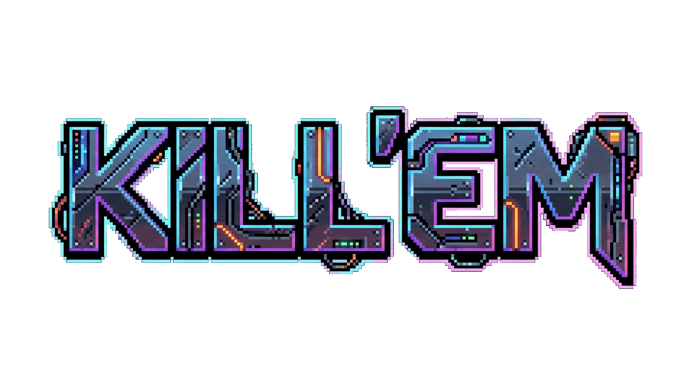
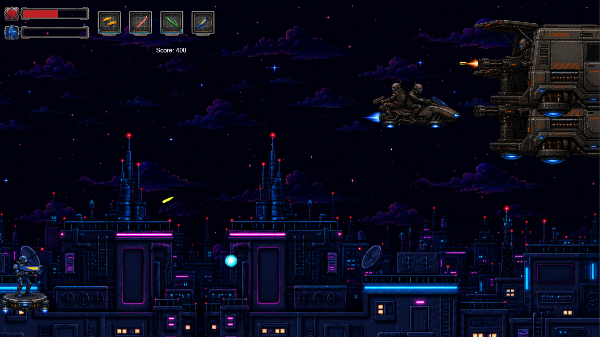

<p align="center">
  
</p>

<p align="center">
  <strong>Enfrente ondas de robôs e sobreviva o máximo que puder.</strong><br>
  Demo jogável direto no navegador, sem instalar nada.
</p>

<p align="center">
  <a href="https://tiagojsaraiva.github.io/kill-em-clankers-game/"><strong>▶ Jogar agora</strong></a>
</p>



## Como jogar

| Tecla | Ação |
|---|---|
| Setas | Mover |
| Espaço | Atacar |
| Q, W, E, R | Trocar de arma |
| F | Tela cheia |

Os ataques vão sempre para a direita, então é preciso se alinhar com um inimigo para acertá-lo, sem ficar parado na mira dos outros. Não há cura: cada ponto de vida conta. A dificuldade sobe nos primeiros 4 minutos e depois fica no máximo até você cair.

**Administre a energia.** Cada arma tem a sua, e ela só recarrega (3 por segundo) enquanto a arma está guardada. Revezar as armas é o que mantém você atirando.

### Armas

| Tecla | Arma | Dano | Intervalo | Energia por ataque | Característica |
|---|---|---|---|---|---|
| Q | Pistola | 10 | 0,58 s | 5 | Econômica, acerta um alvo |
| W | Espada | 20 | 0,67 s | 10 | Corte de curto alcance, atravessa até 5 alvos |
| E | Besta | 20 | 1,17 s | 20 | Virote rápido, atravessa até 4 alvos |
| R | Canhão | 30 | 1,67 s | 20 | Explode ao acertar: 15 de dano em área |

### Inimigos

| Inimigo | Comportamento |
|---|---|
| Shooter | Para na borda da tela e atira na sua direção |
| Van | Resistente; a cada 5 s dispara uma rajada em linha reta na própria altura |
| Granade | Avança, arremessa uma granada onde você está e foge |

Cada um tem três variantes (`normal`, `strong` e `impossible`), que entram conforme a partida avança.

## Rodando localmente

Requer [Node.js](https://nodejs.org) 22 e [pnpm](https://pnpm.io).

```bash
pnpm install
pnpm dev        # servidor local em http://localhost:8080
```

| Comando | O que faz |
|---|---|
| `pnpm dev` | Servidor de desenvolvimento com recarga automática |
| `pnpm build` | Gera a versão de produção em `dist/` |
| `pnpm typecheck` | Verifica os tipos do TypeScript |

## Estrutura

| Caminho | Conteúdo |
|---|---|
| `src/game/main.ts` | Configuração do Phaser e lista de cenas |
| `src/game/scenes/` | Cenas: `preloader`, `main-menu`, `game` e `game-over` |
| `src/game/scenes/game/services/stage/createStageService.ts` | Curva de dificuldade: quando cada fase começa, o intervalo de spawn e quem aparece |
| `src/game/player/` | Jogador, armas (`weapons/WeaponsCatalog.ts`) e projéteis |
| `src/game/enemies/` | Inimigos, cada um com suas variantes de vida, dano, velocidade e pontos |
| `src/game/UI/` | Barras de vida e energia, e slots de arma |
| `public/` | Tudo que vai para o site: imagens, áudio e estilo da página |
| `art-source/` | Originais e rascunhos de arte; **não** é publicado |

O jogo sempre roda em 1920×1080 e o canvas é escalado para caber na janela. Por isso, as posições no código são fixas nessa resolução.

## Deploy

O workflow [`.github/workflows/deploy.yml`](.github/workflows/deploy.yml) verifica os tipos e gera o build em todo pull request. A cada push na `main`, ele também publica o resultado no GitHub Pages. Trabalho em andamento fica em branch, porque o que entra na `main` vai direto para os jogadores.

## Créditos e licença

Desenvolvido por [TiagoJSaraiva](https://github.com/TiagoJSaraiva) com [Phaser 3](https://phaser.io), [TypeScript](https://www.typescriptlang.org) e [Vite](https://vitejs.dev), a partir do [template oficial do Phaser](https://github.com/phaserjs/template-vite-ts).

**Código:** licença MIT; veja [LICENSE](LICENSE).

**Arte:** criada com IA generativa e editada por TiagoJSaraiva. Não está sob a licença MIT.

**Música e efeitos sonoros:** de terceiros, com licenças próprias, e não estão sob a licença MIT.

<!-- TODO: faixa, artista, link e licença de cada música e efeito sonoro. -->
